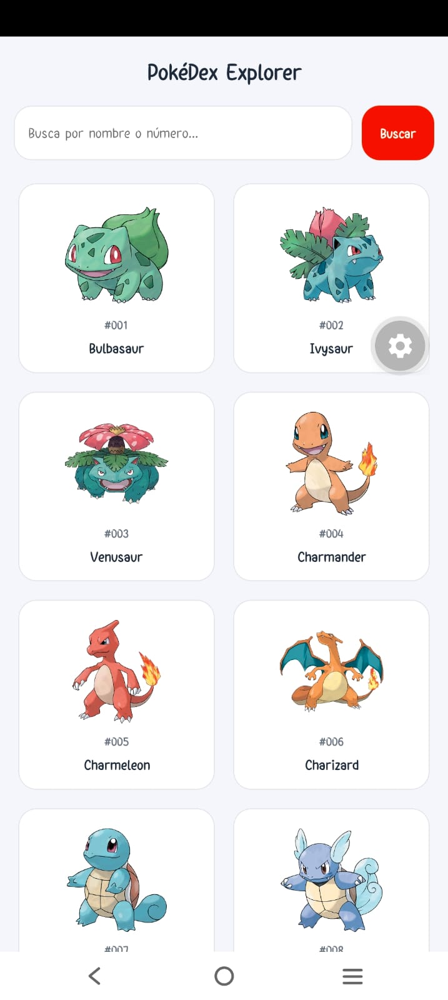
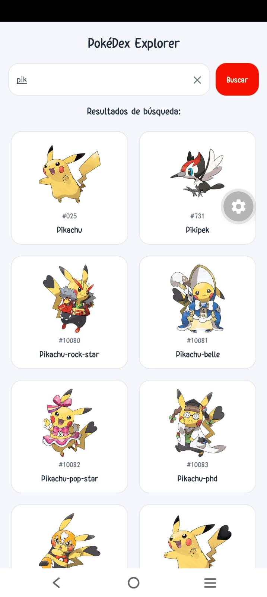
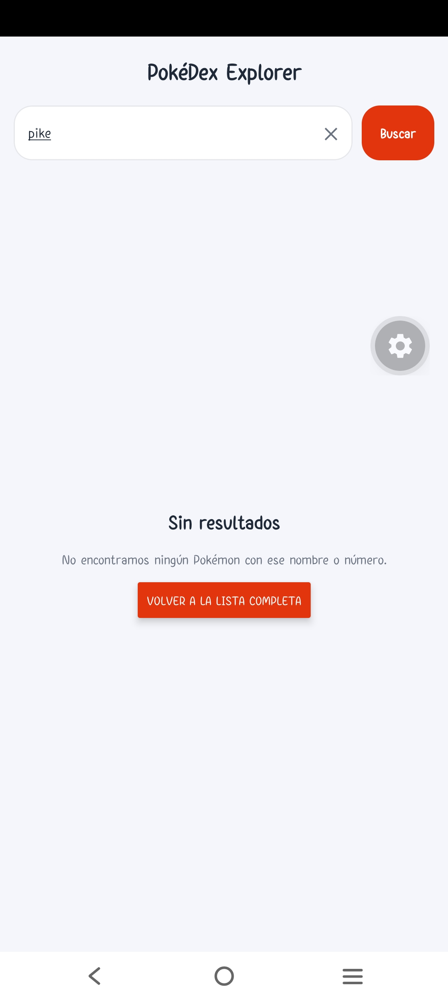
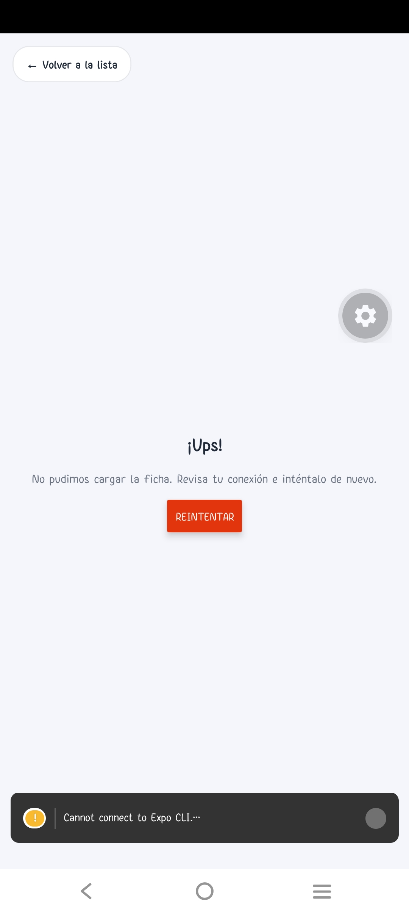
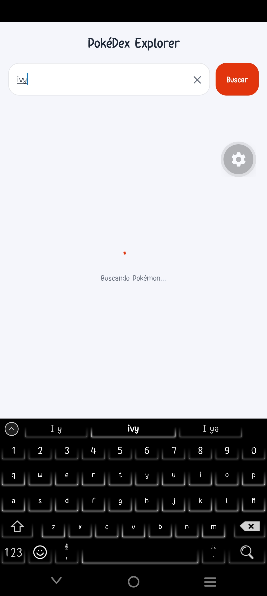
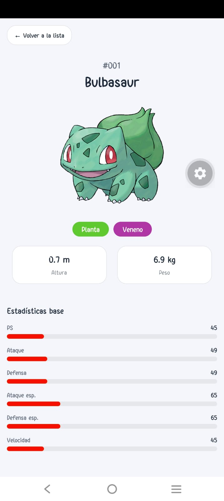

# PokéDex Explorer

App móvil hecha con **React Native + Expo** que consume la [PokéAPI](https://pokeapi.co/) (pública, sin API key).
Lista Pokémon con scroll infinito, permite buscarlos por nombre o número y muestra su ficha con imagen, tipos,
altura, peso y estadísticas base.

## Cómo ejecutarla

```bash
npm install
npx expo start
```

Escanea el QR con **Expo Go**, o presiona `a` (emulador Android) / `i` (simulador iOS).
No se instaló ninguna librería HTTP: se usa `fetch`, que viene incluido.

## Estructura de carpetas

```
App.js                          Decide qué vista se muestra (lista o detalle)
index.js                        Punto de entrada de Expo
src/
├─ api/
│  └─ pokeApi.js                Única capa que llama a fetch: lista, todos los nombres y detalle
├─ hooks/
│  ├─ usePokemonList.js         Lista paginada: datos, cargando, error y "cargar más"
│  ├─ usePokemonSearch.js       Búsqueda: texto, resultados, estados y botón "Buscar"
│  └─ usePokemonDetail.js       Ficha de un Pokémon: datos, cargando, error y "reintentar"
├─ screens/
│  ├─ ListScreen.js             Título, barra de búsqueda y cuadrícula; elige qué estado mostrar
│  └─ DetailScreen.js           Ficha completa del Pokémon
├─ components/
│  ├─ PokemonCard.js            Tarjeta de la cuadrícula (imagen, número y nombre)
│  ├─ StatBar.js                Barra de una estadística (ancho = valor / 255)
│  ├─ LoadingView.js            Estado "cargando"
│  ├─ ErrorView.js              Estado "error" con botón "Reintentar"
│  └─ EmptyView.js              Estado "sin resultados"
├─ utils/
│  └─ format.js                 Funciones puras: número #025, mayúscula inicial, id desde la URL,
│                               colores y traducciones de tipos y estadísticas
└─ theme/
   └─ index.js                  Colores, espaciado y radios en un solo lugar
```

## Por qué la organizamos así

La regla del taller es que las llamadas a la API no queden mezcladas con los estilos y el JSX.
Por eso separamos cuatro capas, cada una con una sola responsabilidad:

| Capa          | Responsabilidad                                                         | Qué NO tiene       |
| ------------- | ----------------------------------------------------------------------- | ------------------ |
| `api/`        | Hacer las peticiones y revisar `response.ok` antes de `response.json()` | JSX ni estilos     |
| `hooks/`      | Guardar el estado (datos, cargando, error) y llamar a `api/`            | JSX ni estilos     |
| `screens/`    | Unir hooks y componentes para armar una pantalla                        | Llamadas a `fetch` |
| `components/` | Dibujar una pieza con las props que recibe                              | Llamadas a la API  |

Ventajas: si la API cambia solo se toca `pokeApi.js`; las pantallas quedan cortas y fáciles de leer;
`LoadingView`, `ErrorView` y `EmptyView` se reutilizan en la lista, la búsqueda y el detalle.

## Estados de la interfaz

Toda petición muestra en qué estado está:

| Estado         | Qué ve el usuario                                            |
| -------------- | ------------------------------------------------------------ |
| Cargando       | Indicador de carga con texto                                 |
| Error          | Mensaje en español y botón "Reintentar"                      |
| Sin resultados | "Sin resultados" cuando el nombre o número buscado no existe |
| Éxito          | La lista, los resultados o la ficha                          |

## Decisiones técnicas

- **Scroll infinito:** `FlatList` con `onEndReached`. Carga 20 Pokémon al abrir y 20 más al llegar al final.
  Un `useRef` evita peticiones duplicadas porque `onEndReached` puede dispararse varias veces seguidas.
- **Búsqueda:** se descarga **una sola vez** la lista de nombres (~1300) y se filtra en el teléfono.
  Así no hay una petición por cada letra. Busca en vivo (espera 500 ms desde la última tecla) y
  también con el botón "Buscar", que busca de inmediato. Acepta nombre (coincidencia parcial) o número,
  ignorando mayúsculas y espacios.
- **`useEffect`:** el array de dependencias controla cuándo se repite la petición. En el detalle solo
  depende del id y del contador de "Reintentar", y la función de limpieza ignora respuestas tardías.
- **Navegación:** sin librería. `App.js` usa un `useState` para elegir la vista y mantiene la lista
  montada (oculta) mientras se ve el detalle, para no perder los Pokémon cargados ni el scroll.
- **Unidades:** la API da la altura en decímetros y el peso en hectogramos; se divide entre 10.

## Capturas

## Capturas








## Reflexión

1. Consumo de la API.
   Aprendimos a consumir la PokéAPI con fetch y async/await. Lo más importante fue revisar response.ok antes de response.json(), porque cuando un Pokémon no existe la API responde 404 con texto plano y no con JSON; si no se revisa, la app se rompe. También aprendimos a manejar los tres resultados de toda petición: cargando, error y éxito.

2. Arquitectura.
   Separamos el proyecto en capas: api/ hace las peticiones, hooks/ guarda el estado, screens/ arma las pantallas y components/ dibuja piezas reutilizables. Lo hicimos así para que las llamadas a la API no queden mezcladas con el JSX. Una ventaja concreta es que si la API cambia, solo se modifica pokeApi.js. Al principio el detalle tenía el fetch dentro de la pantalla; lo movimos a un hook (usePokemonDetail) para que fuera coherente con la lista y la búsqueda.
